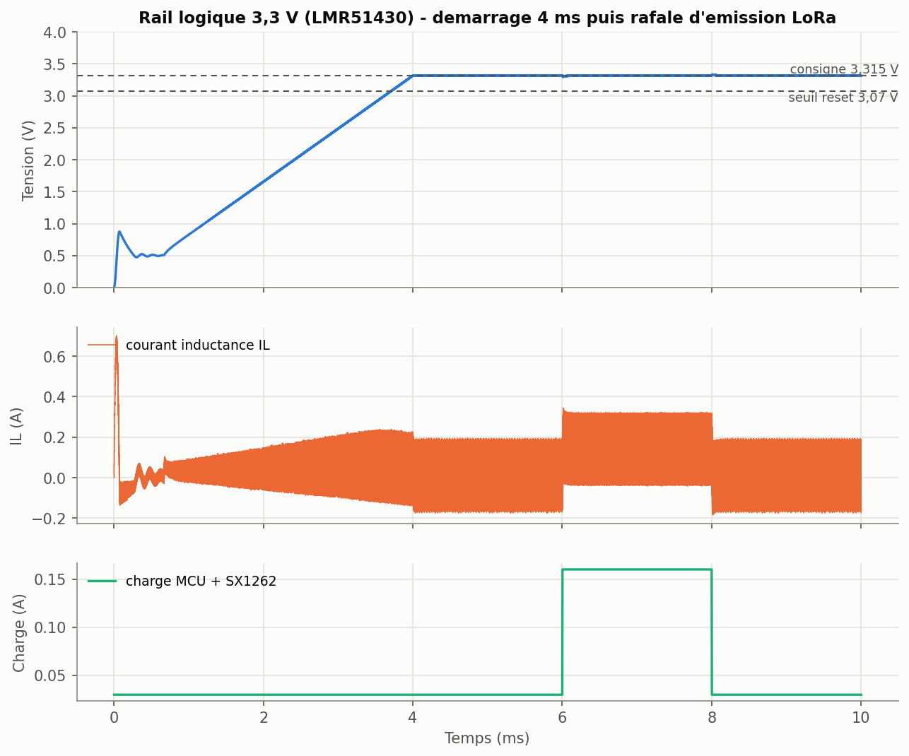
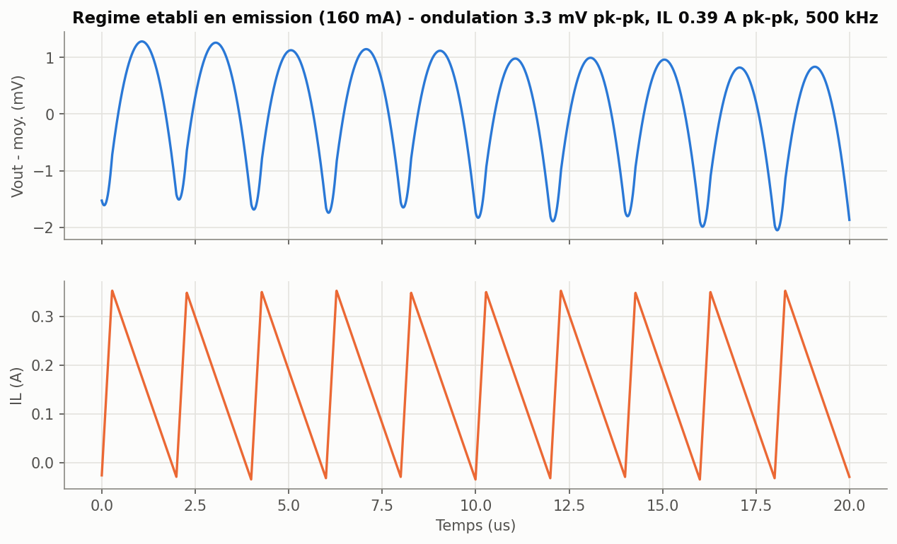
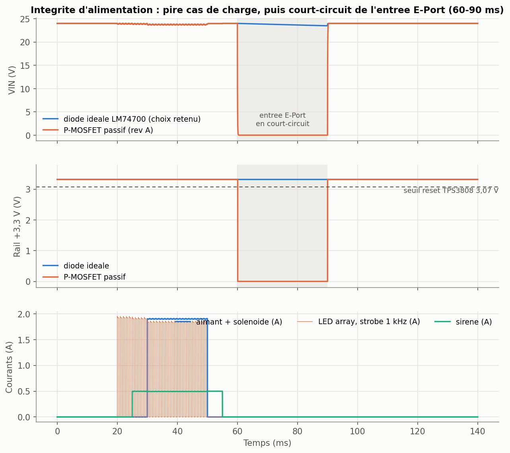
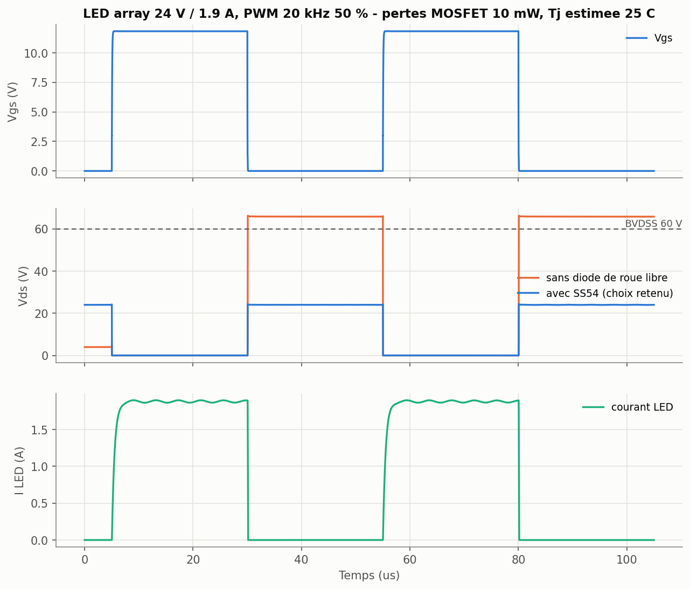
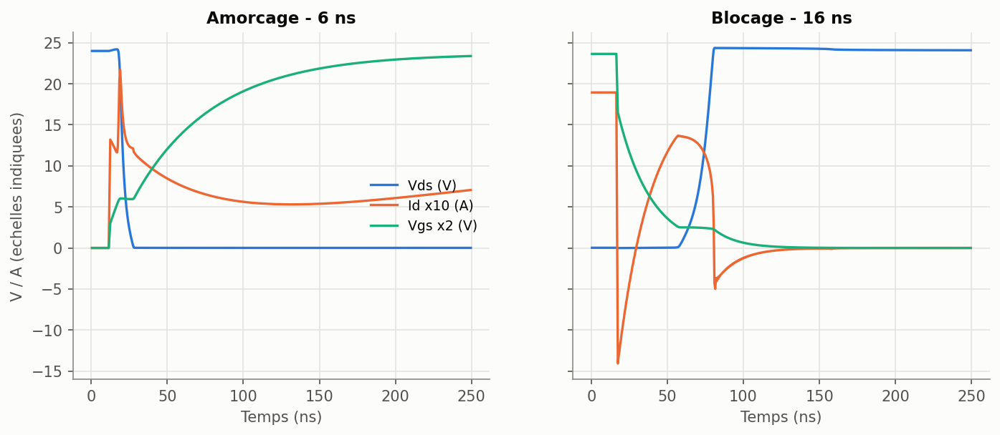
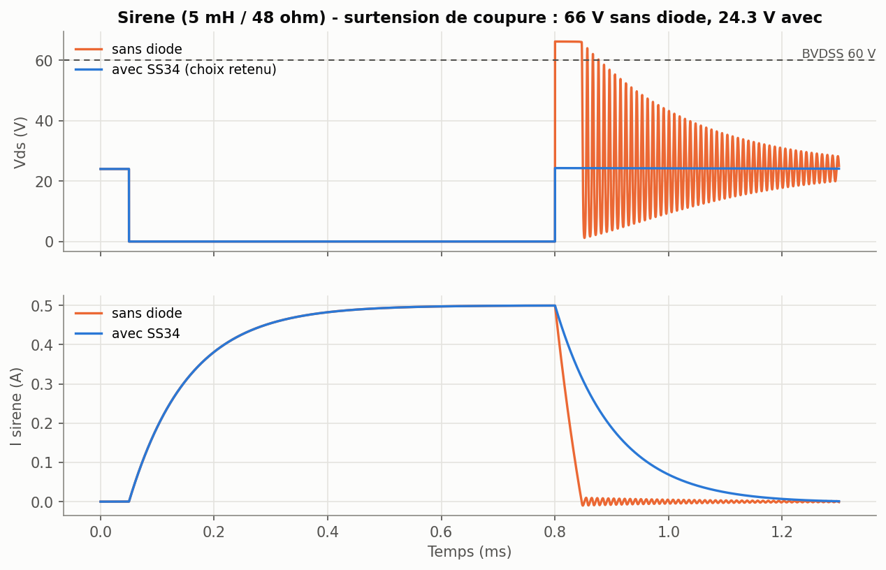
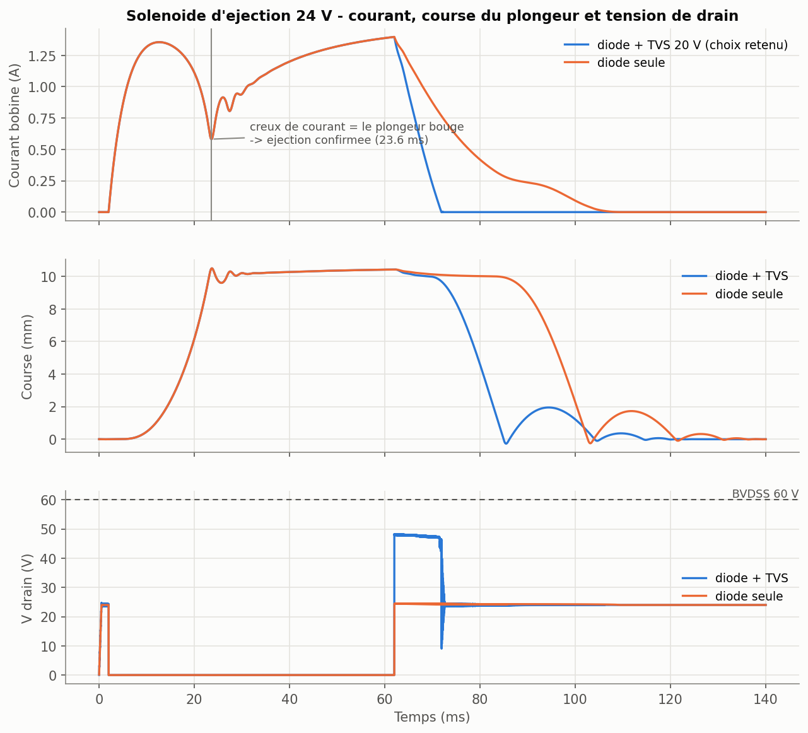
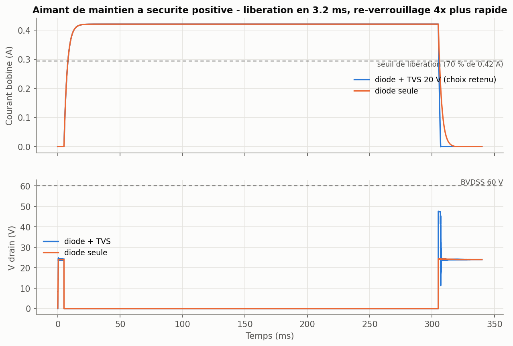
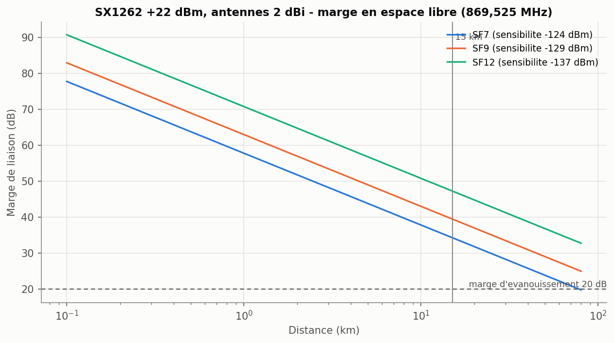

# BRC-M400 Rev C — Rapport de simulation électronique
**Équipe INSATECH — AeroDay V14, Challenge CAO**

**Outil :** ngspice, le moteur de simulation intégré à KiCad 10, piloté par `sim_electronique.py`.
**Méthode :** chaque circuit est décrit en SPICE (fichiers `netlists/*.cir`). Les modèles sont **comportementaux** : ils reproduisent l'architecture et les valeurs clés des datasheets, sans être les modèles transistor des constructeurs. Les limites de chaque modèle sont indiquées dans sa section.

| # | Simulation | Question posée | Réponse |
|---|---|---|---|
| 1 | Convertisseur 3,3 V | La logique reste-t-elle stable pendant une émission LoRa ? | **Oui** : −19,6 mV (0,6 %), 3,3 mV d'ondulation |
| 2 | Intégrité d'alimentation | Un pic de consommation ou une coupure de l'E-Port fait-il redémarrer le MCU ? | **Non, grâce au LM74700** (un P-MOSFET passif s'effondre en 85 µs) |
| 3 | Rampe LED en PWM | Le MOSFET chauffe-t-il ? | **10 mW, Tj ≈ 25 °C**, pas de dissipateur |
| 4 | Sirène | La diode de roue libre est-elle nécessaire ? | **Oui** : 66 V (avalanche) sans elle |
| 5 | **Solénoïde d'éjection** | Le MCU peut-il **confirmer** que l'éjection a eu lieu ? | **Oui** : creux de courant en fin de course, détecté à 23,6 ms |
| 6 | **Aimant de maintien** | En combien de temps la bouée est-elle libérée ? Le drain est-il protégé ? | **3,2 ms** ; drain ≤ 47,6 V, sous les 60 V du MOSFET |
| 7 | Bilan de liaison LoRa | Quelle portée et quelle latence ? | **40 dB de marge à 15 km, 165 ms (SF9)** |

---

## 1. Convertisseur 24 V → 3,3 V (LMR51430, rail logique)

**Modèle :**
- Commutation réelle à 500 kHz.
- Contrôle en mode courant crête : bascule PWM, rampe de compensation, correcteur PI avec anti-emballement de l'intégrateur.
- Démarrage progressif de 4 ms et résistances des interrupteurs (120 / 70 mΩ), d'après le datasheet TI.
- Inductance de 15 µH ; 35 µF de céramique effectifs en sortie.
- Le correcteur est réglé pour une fréquence de coupure de boucle d'environ 37 kHz, compatible avec 35 µF de sortie.




| Grandeur | Simulé | Attendu |
|---|---|---|
| Tension de sortie | **3,315 V** | 3,315 V (0,600 × 122,1 / 22,1) |
| Ondulation de la sortie (en émission) | **3,3 mV crête à crête** | — |
| Ondulation du courant dans l'inductance | **0,39 A crête à crête** | 0,38 A, calculé |
| Échelon 30 → 160 mA (émission LoRa) | **−19,6 mV (0,6 %)** : la tension reste dans ±1 % | — |
| Retour à 30 mA | +17,8 mV | — |

*Le modèle fonctionne en PWM forcée. Le vrai LMR51430X passe en mode PFM à faible charge : rendement meilleur, ondulation un peu plus élevée.*

---

## 2. Intégrité d'alimentation et court-circuit sur l'E-Port

**Modèle :**
- Port E-Port V2 de 24 V avec son impédance (30 mΩ + câble) et le réservoir C3 de 470 µF.
- Convertisseurs en modèle moyen, avec seuil de sous-tension.

**Charges :**
- Aimant de maintien : 57 Ω.
- Solénoïde d'éjection : 16 Ω.
- Rampe LED : 1,88 A en flash à 1 kHz.
- Sirène : 48 Ω.
- Logique : 30 mA, puis 160 mA pendant l'émission.

**Scénario :**
1. De 30 à 50 ms, **toutes les charges ensemble** (cas qui n'arrive pas en usage normal, voir plus bas).
2. De 60 à 90 ms, **court-circuit de l'entrée E-Port**.



| Résultat | Diode idéale LM74700 | P-MOSFET passif |
|---|---|---|
| Courant maximal tiré sur l'E-Port, toutes charges ensemble | **4,25 A** (limite : 5 A) | identique |
| VIN minimal | 23,67 V | identique |
| **Rail 3,3 V pendant le court-circuit de 30 ms** | **tient à 3,315 V** (VIN reste à 23,5 V) | **passe sous 3,0 V en 85 µs → reset du MCU** |

→ **Séquencement imposé au firmware.** On libère d'abord la bouée (maintien + éjection ≈ 2 A). On n'allume la balise (LED + sirène ≈ 2,4 A) qu'après la confirmation du largage. Le courant réel reste ainsi **sous 2,5 A**.

---

## 3. Rampe LED en PWM (UCC27511A + BSC028N06LS3, grille attaquée en 12 V)

**Modèle :**
- **Rampe LED 24 V :** seuil de 20 V, résistance de 2 Ω, câblage de 1 µH.
- **MOSFET :** modèle VDMOS ajusté sur la fiche Infineon.
- **Driver de grille :** UCC27511A alimenté en 11,85 V ; résistances de grille de 4,7 Ω à l'allumage et 1 Ω à l'extinction.




| Grandeur | Valeur |
|---|---|
| Courant LED / RDS(on) | 1,88 A / **1,76 mΩ** |
| Fronts de Vds | 6 ns à l'allumage · 16 ns à l'extinction |
| Pertes dans le MOSFET à 20 kHz | **10 mW**, soit Tj ≈ 25 °C sans dissipateur |
| Pic de Vds au blocage | **24,4 V avec la SS54 · 66 V sans elle (avalanche)** |

---

## 4. Sirène : coupure d'une charge inductive



- **Sans diode de roue libre :** Vds monte à **66 V** et le MOSFET passe en avalanche, avec 0,62 mJ dissipés à chaque coupure.
- **Avec la SS34 :** la tension reste limitée à **24,3 V**.

---

## 5. Solénoïde d'éjection — modèle électromécanique

**Modèle :** solénoïde pousseur 24 V / 16 Ω, de course 10 mm, avec un ensemble plongeur + tige de 30 g.
- **Bobine :** on intègre le flux λ, et le courant vaut I = λ / L(x), avec une inductance qui dépend de la position du plongeur : L(x) = 10 mH + 0,6 mH·m / (13 mm − x).
- **Force magnétique :** F = ½ · I² · dL/dx.
- **Mécanique :** ressort de rappel de 300 N/m avec 1 N de précharge, frottement visqueux et butées.
- **Commande :** impulsion FIRE de 60 ms.
- **Deux protections comparées :** diode seule, ou diode + TVS de 20 V (démagnétisation rapide).



| Grandeur | Valeur |
|---|---|
| Pic de courant avant le démarrage du plongeur | 1,36 A à 12,6 ms |
| **Creux de courant pendant la course** (force contre-électromotrice) | 0,58 A |
| Fin de course | 23,1 ms |
| **Éjection confirmée par le MCU** (minimum du creux sur l'ADC) | **23,6 ms** |
| Force : au départ / en fin de course | 1,3 N / 88 N |
| Retour du plongeur après coupure | **22 ms avec diode + TVS**, contre 40 ms avec une diode seule |
| Tension de drain au blocage | 48,2 V avec diode + TVS (sous les 60 V du MOSFET) · 24,4 V avec une diode seule |

**Pourquoi c'est important :** sans aucun capteur supplémentaire, **la signature du courant prouve que le plongeur a réellement bougé**. Un plongeur bloqué ne produit pas de creux, et le firmware signale alors un défaut au pilote au lieu d'allumer la balise.

---

## 6. Électroaimant de maintien à sécurité positive

**Modèle :** bobine de 24 V / 57 Ω (10 W) et 150 mH. La libération a lieu quand le courant atteint 70 % de sa valeur nominale, c'est-à-dire quand le champ de la bobine annule celui de l'aimant permanent.



| Grandeur | Valeur |
|---|---|
| Courant nominal | 0,42 A |
| **Libération** | **3,2 ms** après l'ordre FIRE |
| Démagnétisation à 5 % (réverrouillage) | **1,7 ms avec diode + TVS**, contre 7,5 ms avec une diode seule (4,4 fois plus rapide) |
| Tension de drain maximale | 47,6 V (sous les 60 V du MOSFET) |

*Avec un aimant classique (bobine alimentée = maintien), c'est la vitesse de démagnétisation qui fixe le temps de lâcher. La protection diode + TVS divise alors ce délai par 4,4.*

---

## 7. Bilan de liaison LoRa (SX1262, 869,525 MHz)

**Hypothèses :** +22 dBm en émission, antennes de 2 dBi, 1 dB de pertes, propagation en espace libre, sensibilités du datasheet Semtech (SF8 à SF11 interpolés).



| SF | Sensibilité | Marge à 15 km | Temps d'antenne (16 octets) |
|---|---|---|---|
| 7 | −124,0 dBm | 34,3 dB | 51 ms |
| 8 | −126,6 dBm | 36,9 dB | 93 ms |
| **9** | **−129,2 dBm** | **39,5 dB** | **165 ms** |
| 10 | −131,8 dBm | 42,1 dB | 330 ms |
| 11 | −134,4 dBm | 44,7 dB | 659 ms |
| 12 | −137,0 dBm | 47,3 dB | 1 319 ms |

---

## 8. Simulation dans KiCad — fichier `kicad_sim/SIM_LED_PWM.kicad_sch`

Ce schéma KiCad simule l'étage de la rampe LED, avec une commande de grille en 12 V. Il passe le contrôle des règles électriques (ERC) sans aucune violation. **La netlist exportée par KiCad a été vérifiée dans ngspice :** grille à 11,99 V, drain à 22,3 mV à l'état passant et à 24,0 V à l'état bloqué, courant LED de 1,88 A, pic écrêté à 24,3 V. Les résultats sont identiques à §3.

**Pour la lancer :**

1. Ouvrir `SIM_LED_PWM.kicad_pro`, puis le schéma.
2. Menu **Inspect → Simulator**, puis **Run** (flèche verte).
3. **Add Signals** → choisir `V(/DRAIN)`, `V(/GATE)` et `I(L1)`.
4. Expérience : clic droit sur **D1** → *Exclude from simulation*, puis relancer → **la surtension de 66 V apparaît**.

---

## 9. Relancer les simulations Python

```
cd 03_SIMULATION/electronique
python sim_electronique.py                       # les 7 simulations (~15 min, surtout le convertisseur)
python sim_electronique.py eject hold led siren   # un sous-ensemble : buck system led siren eject hold link
```

- **Dépendances :** Python 3 avec numpy et matplotlib, plus KiCad 10 (la DLL `ngspice.dll` est reprise de KiCad).
- **Sorties :** les figures dans `figures/`, les données brutes dans `data/`, les netlists SPICE dans `netlists/`.
